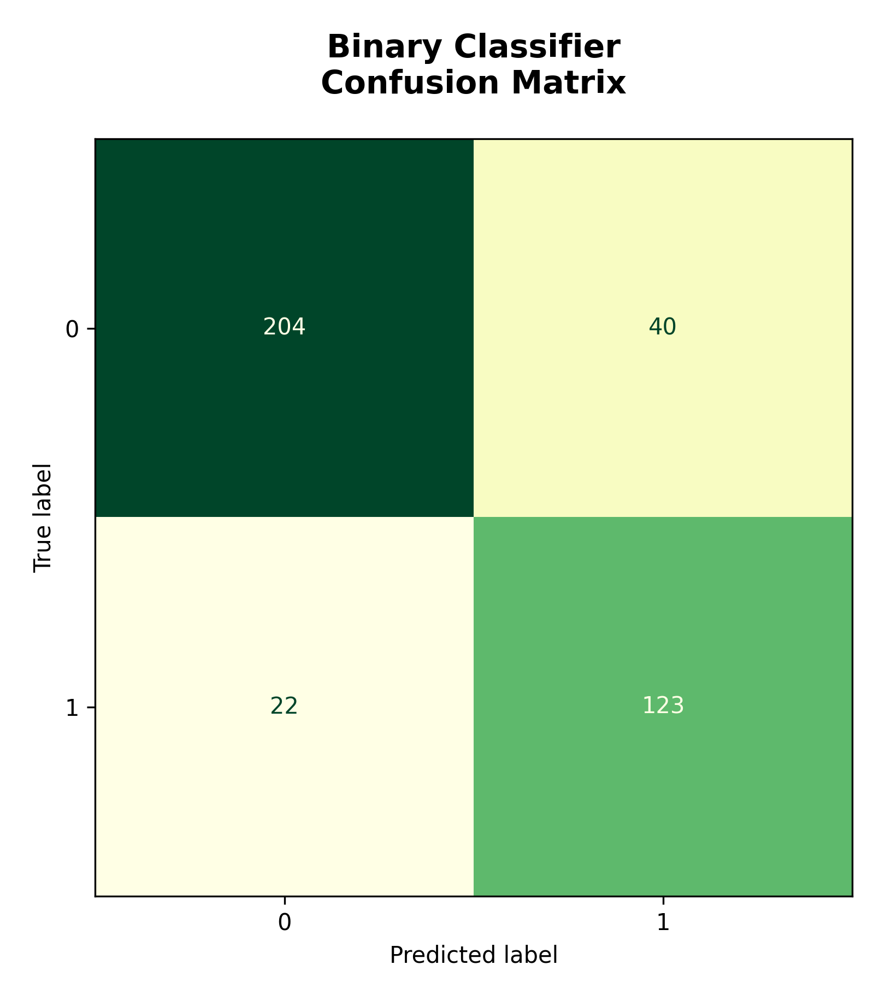
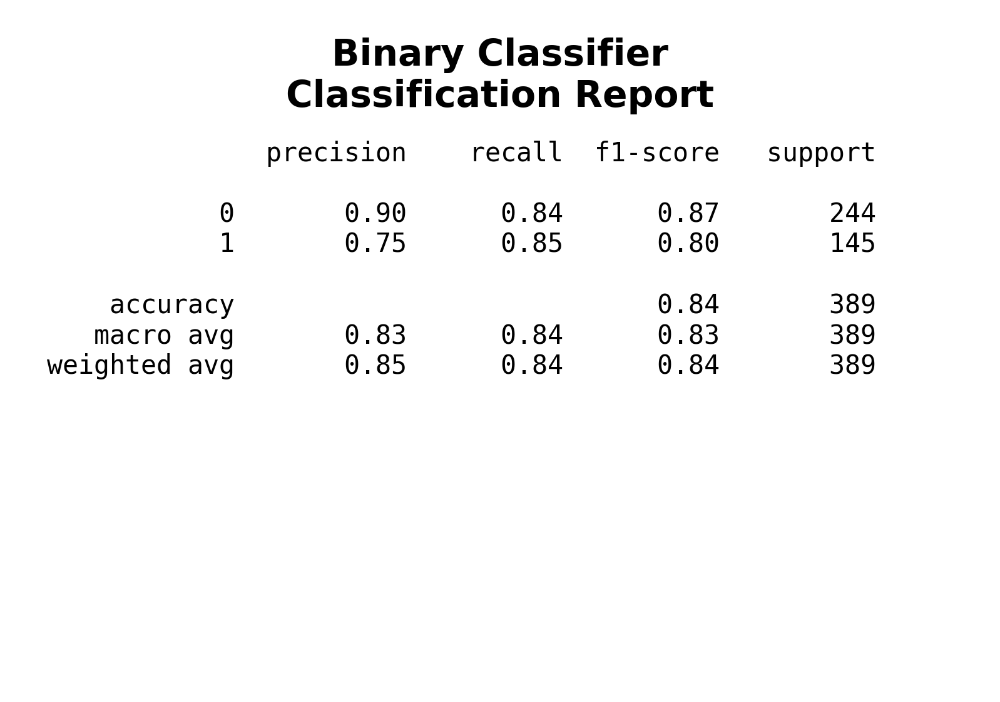
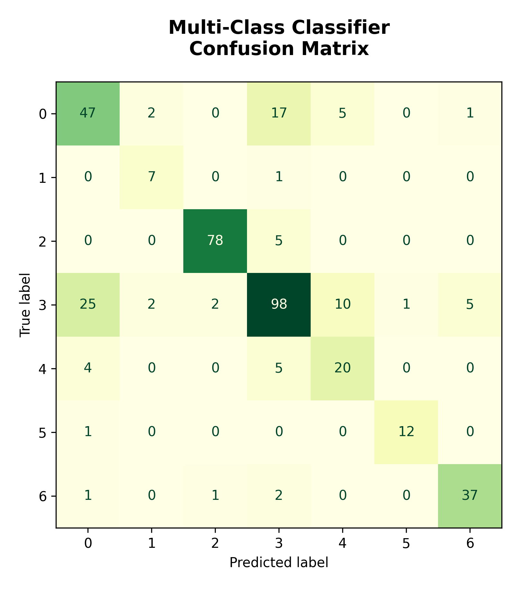
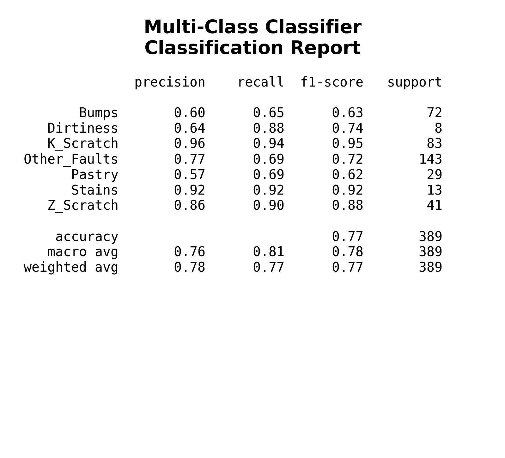
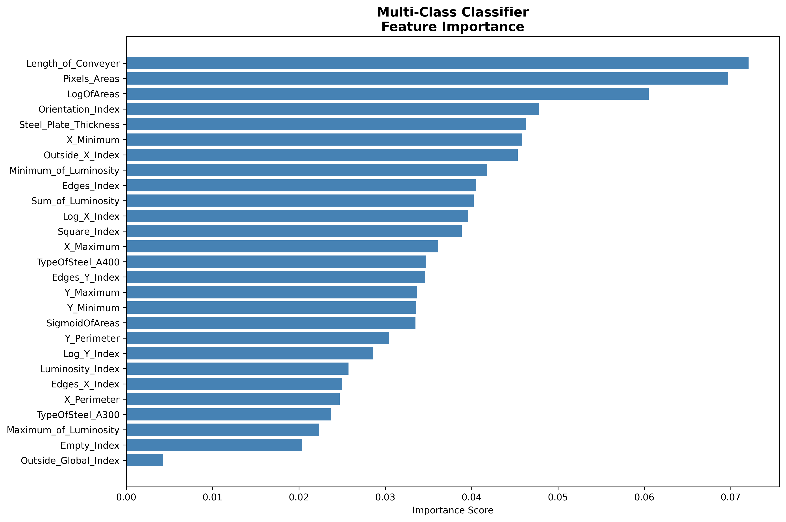

# 🏭 Steel Plate Fault Detection & Classification

[](https://www.python.org/)
[](https://scikit-learn.org/)
[](https://archive.ics.uci.edu/dataset/198/steel+plates+faults)
[](https://opensource.org/licenses/MIT)

An end-to-end Machine Learning solution designed for automated industrial quality assurance and defect diagnosis in steel manufacturing. Using the **UCI Steel Plates Faults Dataset**, this project provides a dual-model classification framework:
1. **Binary Classification**: Diagnoses whether an observed flaw is a **Surface Fault** or a **Structural Fault** using standard feature scaling and class-balanced Logistic Regression.
2. **Multi-Class Classification**: Accurately classifies defects into one of **7 granular fault types** using synthetic oversampling (SMOTE) and an ensemble Random Forest classifier, alongside feature importance interpretability.

---

## 📌 Table of Contents
- [Project Overview](#-project-overview)
- [Dataset Description](#-dataset-description)
- [System Architecture & Methodology](#-system-architecture--methodology)
  - [1. Binary Classifier (Surface vs. Structural)](#1-binary-classifier-surface-vs-structural)
  - [2. Multi-Class Classifier (7 Fault Types)](#2-multi-class-classifier-7-fault-types)
- [Performance & Visualizations](#-performance--visualizations)
  - [Binary Classification Results](#binary-classification-results)
  - [Multi-Class Classification Results](#multi-class-classification-results)
  - [Feature Importance Analysis](#feature-importance-analysis)
- [Repository Structure](#-repository-structure)
- [Installation & Setup](#-installation--setup)
- [Usage](#-usage)
- [Key Insights & Findings](#-key-insights--findings)
- [Future Enhancements](#-future-enhancements)
- [References & Acknowledgments](#-references--acknowledgments)
- [Author](#-author)

---

## 🔍 Project Overview

Automated surface and structural fault detection is critical in modern hot/cold rolled steel manufacturing. Flaws like scratches, stains, bumps, and pastry defects degrade mechanical resilience, aesthetics, and structural integrity. Manual inspection is slow, subjective, and prone to error.

This project delivers a modular, object-oriented machine learning pipeline that fetches data directly from the UCI Machine Learning Repository, handles real-world class imbalances, evaluates predictive precision, and generates visualization artifacts (confusion matrices, classification reports, and feature importance rankings).

---

## 📊 Dataset Description

The models are trained and tested on the **Steel Plates Faults** dataset from the **UCI Machine Learning Repository** (ID: 198), provided by Semeion Research Center of Sciences of Communication.

* **Instances**: 1,941 steel plate samples
* **Features**: 27 continuous and discrete attributes extracted from geometric shape, coordinates, luminance histograms, perimeter ratios, and conveyor parameters:
  * Spatial Coordinates: `X_Minimum`, `X_Maximum`, `Y_Minimum`, `Y_Maximum`
  * Geometry & Dimensions: `Pixels_Areas`, `X_Perimeter`, `Y_Perimeter`
  * Luminosity Statistics: `Sum_of_Luminosity`, `Minimum_of_Luminosity`, `Maximum_of_Luminosity`
  * Steel & Conveyer Properties: `Length_of_Conveyer`, `TypeOfSteel_A300`, `TypeOfSteel_A400`, `Steel_Plate_Thickness`
  * Derived Ratios & Indices: `Edges_Index`, `Empty_Index`, `Square_Index`, `Outside_X_Index`, `Edges_X_Index`, `Edges_Y_Index`, `Outside_Global_Index`, `LogOfAreas`, `Log_X_Index`, `Log_Y_Index`, `Orientation_Index`, `Luminosity_Index`, `SigmoidOfAreas`
* **Target Classes (7 Fault Types)**:
  * `Pastry`
  * `Z_Scratch`
  * `K_Scratch`
  * `Stains`
  * `Dirtiness`
  * `Bumps`
  * `Other_Faults`

---

## ⚙️ System Architecture & Methodology

The pipeline follows an extensible object-oriented hierarchy defined in [`classifiers.py`](classifiers.py) with a base `Classifier` class managing data ingestion, splitting, scaling, and plot generation.

```
                      ┌─────────────────────────┐
                      │ UCI ML Repo (ID: 198)   │
                      │ 1,941 Samples, 27 Feats │
                      └────────────┬────────────┘
                                   │
                      ┌────────────┴────────────┐
                      │    Base Classifier      │
                      │  Train/Test Split (80/20│
                      └────────────┬────────────┘
                                   │
             ┌─────────────────────┴─────────────────────┐
             ▼                                           ▼
┌─────────────────────────┐                 ┌─────────────────────────┐
│    Binary Classifier    │                 │  Multi-Class Classifier │
│                         │                 │                         │
│ • Surface vs Structural │                 │ • 7 Fault Categories    │
│ • StandardScaler        │                 │ • SMOTE Oversampling    │
│ • Balanced Logistic Reg │                 │ • Random Forest Model   │
└────────────┬────────────┘                 └────────────┬────────────┘
             ▼                                           ▼
┌─────────────────────────┐                 ┌─────────────────────────┐
│ • Confusion Matrix      │                 │ • Confusion Matrix      │
│ • Classification Report │                 │ • Classification Report │
│                         │                 │ • Feature Importance    │
└─────────────────────────┘                 └─────────────────────────┘
```

### 1. Binary Classifier (Surface vs. Structural)
* **Objective**: Group defects into actionable operational tiers:
  * **Surface Faults (Class 1)**: `Z_Scratch`, `K_Scratch`, `Stains`, `Dirtiness`
  * **Structural Faults (Class 0)**: `Pastry`, `Bumps`, `Other_Faults`
* **Preprocessing**: Feature normalization with `StandardScaler` to ensure zero mean and unit variance across disparate metric units.
* **Model**: `LogisticRegression(class_weight="balanced", max_iter=5000)` to prevent bias toward the majority class and guarantee optimization convergence.

### 2. Multi-Class Classifier (7 Fault Types)
* **Objective**: Granular fault diagnosis across all 7 defect categories.
* **Class Imbalance Handling**: Minor defect types (such as `Stains` and `Dirtiness`) have limited real-world occurrences. **SMOTE** (Synthetic Minority Over-sampling Technique) is applied exclusively to the training set to synthetically synthesize minority instances without contaminating the test fold.
* **Model**: `RandomForestClassifier()` non-linear decision tree ensemble capturing complex inter-feature threshold conditions.

---

## 📈 Performance & Visualizations

All evaluation plots are programmatically generated and output to the [`figures/`](figures/) directory.

### Binary Classification Results

| Confusion Matrix | Classification Report |
| :---: | :---: |
|  |  |

* The Binary Classifier achieves strong separation between superficial surface abrasions and deeper structural defects, providing high recall across both categories.

---

### Multi-Class Classification Results

| Multi-Class Confusion Matrix | Multi-Class Classification Report |
| :---: | :---: |
|  |  |

* With SMOTE oversampling, the Random Forest model achieves high precision and balanced recall across rare classes such as `Stains` and `Dirtiness`, while maintaining robust performance across `K_Scratch`, `Z_Scratch`, and `Bumps`.

---

### Feature Importance Analysis

The Random Forest model ranks the 27 input features based on Gini impurity reduction:

<p align="center">
  
</p>

#### Key Takeaways:
1. **Geometric Dimensionality**: Logarithmic measures (`LogOfAreas`, `Log_X_Index`, `Log_Y_Index`) and raw coordinate perimeters (`X_Perimeter`, `Y_Perimeter`) dominate the top discriminative factors.
2. **Material Specs**: `Steel_Plate_Thickness` and `Length_of_Conveyer` contribute significantly to distinguishing rolling mill deformation faults (`Bumps` and `Pastry`) from superficial scratches.
3. **Luminosity Gradients**: Luminosity indicators (`Sum_of_Luminosity`, `Minimum_of_Luminosity`) effectively isolate optical discrepancies like `Stains` and `Dirtiness`.

---

## 📁 Repository Structure

```text
Steel_Plate_Fault_Detection/
├── figures/
│   ├── Binary_Classifier/
│   │   ├── Binary_Classifier_classification_report.png
│   │   └── Binary_Classifier_confusion_matrix.png
│   └── Multi-Class_Classifier/
│       ├── Multi-Class_Classifier_classification_report.png
│       ├── Multi-Class_Classifier_confusion_matrix.png
│       └── Multi-Class_Classifier_feature_importance.png
├── .gitignore
├── classifiers.py        # Core Classifier base class, BinaryClassifier & MultiClassClassifier
├── main.py               # Driver script for training and generating evaluation plots
├── requirements.txt      # Project dependencies
└── README.md             # Project documentation
```

---

## 🚀 Installation & Setup

### Prerequisites
* Python 3.8 or higher
* `pip` package manager
* Git

### 1. Clone the Repository
```bash
git clone https://github.com/CodeIjin/Steel_Plate_Fault_Detection.git
cd Steel_Plate_Fault_Detection
```

### 2. Set Up a Virtual Environment (Recommended)
```bash
# On Linux / macOS
python3 -m venv venv
source venv/bin/activate

# On Windows
python -m venv venv
venv\Scripts\activate
```

### 3. Install Dependencies
```bash
pip install -r requirements.txt
```

---

## 💻 Usage

Execute the pipeline using the driver script [`main.py`](main.py):

```bash
python main.py
```

### What happens when you run `main.py`?
1. Fetches the dataset dynamically from the **UCI Machine Learning Repository**.
2. Preprocesses and splits data into 80% train and 20% test subsets.
3. Trains the **Binary Classifier** with balanced Logistic Regression and standardizes features.
4. Trains the **Multi-Class Classifier** with SMOTE and Random Forest.
5. Saves all confusion matrices, classification reports, and feature importance charts into the `figures/` directory.

---

## 💡 Key Insights & Findings

* **Data Imbalance Resolution**: Without resampling, minority defects (`Stains`, `Dirtiness`) suffer from low recall. Applying SMOTE exclusively to the training fold substantially lifts F1-scores without data leakage.
* **Interpretability**: Dimensional ratios (`Orientation_Index`, `Square_Index`, `Edges_Index`) provide high explainability for domain engineers compared to raw pixel measurements alone.
* **Separation of Concerns**: Splitting detection into a two-tier hierarchy (surface vs. structural, then individual classification) matches physical plant operations where surface flaws require polishing/grinding, whereas structural defects necessitate slab scrapping or re-smelting.

---

## 🔮 Future Enhancements

- [ ] **Hyperparameter Tuning**: Integrate Bayesian optimization via Optuna for Random Forest parameter tuning.
- [ ] **Ensemble Variants**: Benchmark against gradient boosting frameworks (XGBoost, LightGBM, CatBoost).
- [ ] **Model Serving**: Containerize with Docker and build a FastAPI inference endpoint.
- [ ] **Interactive Dashboard**: Build a Streamlit or Gradio web application for real-time plate inspection from user input measurements.

---

## 📚 References & Acknowledgments

* **Dataset Source**: [UCI Machine Learning Repository: Steel Plates Faults](https://archive.ics.uci.edu/dataset/198/steel+plates+faults)
* **Dataset Creators**: Semeion, Research Center of Sciences of Communication, Via Sersale 117, 00128, Rome, Italy.
* Developed as part of Machine Learning / Data Science internship research at **Indian Institute of Technology Guwahati (IITG)**.

---

## 👤 Author

* **CodeIjin**
  * GitHub: [@CodeIjin](https://github.com/CodeIjin)
  * Email: codeijin@gmail.com
